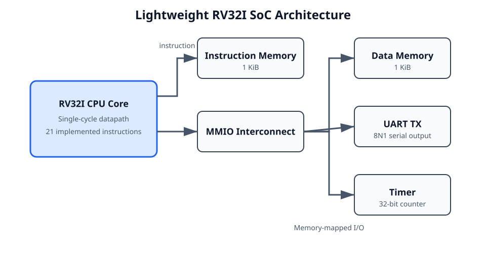
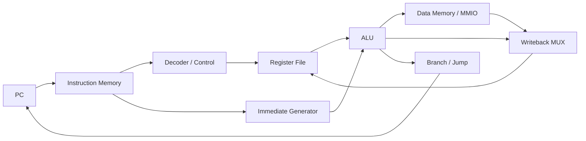
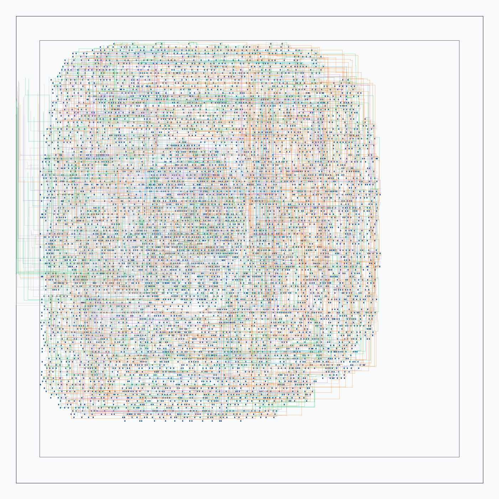

# Design and Implementation of a Lightweight RV32I SoC in SystemVerilog

[English](README.md)

这是一个使用SystemVerilog实现的轻量级RV32I SoC，包含单周期CPU、片上存储、
MMIO UART/Timer、RISC-V裸机软件、自动化验证，以及Yosys → OpenSTA → OpenROAD
前后端流程。

系统级C程序能够完成：

```text
计算1 + 2 + ... + 10 = 55
          ↓
写入并读回Data Memory
          ↓
读取memory-mapped Timer
          ↓
通过UART发送求和结果和Timer快照
```

## Architecture



CPU采用单周期Harvard结构，Instruction Memory和Data Memory相互独立。每条指令在一个
周期内完成取指、译码、寄存器读取、执行、访存和写回选择。



主要模块包括PC、Decoder、Control Unit、逻辑上32×32-bit且物理保存`x1–x31`的双读单写
Register File、Immediate Generator、ALU、Branch/Jump Unit和Writeback MUX。

CPU支持21条RV32I指令：

```text
ADD  SUB  AND  OR   XOR  SLT  SLL  SRL  SRA
ADDI ANDI ORI  XORI
LW   SW
BEQ  BNE
JAL  JALR LUI  AUIPC
```

暂未实现流水线、M扩展、CSR、中断、Cache、AXI、浮点和异常处理。数据访存仅支持对齐的
32-bit `LW/SW`。

## SoC

```text
rv32i_soc
├── rv32i_core
├── Instruction Memory：1 KiB
├── Data Memory：1 KiB
├── MMIO Interconnect
├── UART TX：8N1
└── Timer：32-bit计数器
```

| 地址 | 设备 | 说明 |
|---|---|---|
| `0x0000_0000–0x0000_03ff` | Data Memory | 1 KiB RAM，栈顶为`0x400` |
| `0x1000_0000` | UART TXDATA | 写入低8-bit发送一个字节 |
| `0x1000_0004` | UART STATUS | bit 0为ready |
| `0x1000_0010` | TIMER COUNT | 32-bit计数值 |
| `0x1000_0014` | TIMER CONTROL | bit 0为enable |

UART和Timer都通过普通`LW/SW`访问。Timer使能时每周期加一；UART软件在写TXDATA前轮询
STATUS。Instruction Memory同样从地址0开始，但属于独立物理阵列。

## Verification

验证覆盖ALU、Register File、Immediate Generator、Decoder、Control Unit、PC、Branch/Jump、
IMEM、DMEM、UART、Timer和MMIO。所有testbench自动比较预期值，失败时返回非零状态。

程序级测试包括：

- 汇编程序验证算术、访存、分支、跳转和非法指令无副作用；
- C程序验证`.data/.bss`、栈、普通函数调用和JALR返回；
- CPU通过MMIO控制UART和Timer；
- 系统程序计算55、写回RAM、读取Timer，并发送11-byte UART结果帧；
- testbench从UART TX引脚按8N1时序恢复字节，并与RAM结果交叉核对。

完整回归结果：

| 检查 | 结果 |
|---|---:|
| 4个软件ELF指令白名单 | PASS |
| 全部模块与SoC仿真 | PASS |
| 系统程序 | `sum=55, timer=58` |
| Generic及Nangate45网表重读 | 0 problems |
| Pre-layout STA | WNS `+4.208 ns`，TNS `0 ns` |
| Detailed-route DRC | 0 violations |
| Post-route STA | setup `+5.03 ns`，hold `+0.06 ns` |

## Implementation Results

综合与物理实现对象为`rv32i_core`，不包含Instruction/Data Memory、MMIO Interconnect、
UART、Timer、I/O pad和电源网络。

| 项目 | 结果 |
|---|---:|
| 目标时钟 | 100 MHz |
| Nangate45 cells | 6186 |
| DFF | 1024 |
| 映射面积 | 11254.46 µm² |
| 布局前setup slack / TNS | +4.208 ns / 0 ns |
| Die | 199.32 µm × 199.32 µm |
| Core | 179.17 µm × 177.80 µm |
| Post-route设计面积 | 13624 µm² |
| Core utilization | 43% |
| CTS sinks / buffers | 1024 / 137 |
| 总布线长度 | 126387 µm |
| Via | 53999 |
| OpenROAD detailed-route DRC | 0 violations |
| 布线后setup / hold slack | +5.03 ns / +0.06 ns |

面积不包含SRAM macro、I/O pad、电源网络和封装；时序结果也不代表多PVT corner
signoff。



精简结果保存在[`reports/`](reports/)，流程说明见
[综合与STA说明](docs/13_standard_cell_mapping_sta.md)和
[OpenROAD P&R说明](docs/14_openroad_basic_pnr.md)。

## 使用方法

功能仿真与软件构建需要GNU Make、Python 3、Icarus Verilog（`iverilog`、`vvp`）和
支持RV32I的GNU裸机工具链。`make lint`单独需要Verilator。后端实现流程需要Yosys、
OpenSTA（`sta`）和OpenROAD。所有工具都应位于`PATH`中。
软件工具链默认使用`riscv64-unknown-elf-`前缀，也可以显式指定：

```bash
make RISCV_PREFIX=/opt/riscv/bin/riscv64-unknown-elf- regression
```

```bash
make lint         # CPU和SoC顶层静态检查
make regression   # 构建软件并运行全部self-checking仿真
make synth-core   # Yosys综合及网表结构检查
make timing       # Nangate45映射与布局前STA
make pnr-core     # 仅对CPU core执行P&R和布线后STA
bash scripts/view_layout.sh
make clean
```

## Repository

```text
rtl/          CPU、memory、SoC和外设RTL
tb/           self-checking testbench
software/     汇编/C、crt0、linker script和memory image
docs/         中文模块与实现文档
constraints/  综合、STA和P&R约束
scripts/      Yosys、OpenSTA和OpenROAD流程
platforms/    开源流程使用的Nangate45库文件
reports/      综合、时序和物理实现精简摘要
```

`make clean`会删除软件镜像、build目录、波形、详细报告、网表和物理数据库，并保留
`reports/`下的三份精简summary。所有删除的运行产物都可由上述命令重新生成。
详细模块说明位于[`docs/`](docs/)。完成`make pnr-core`后可在WSLg中查看布局：

```bash
bash scripts/view_layout.sh
```

## 许可证

本仓库的原创源码、脚本和文档采用[MIT License](LICENSE)。`platforms/nangate45/`下的
第三方文件继续遵循其自身的[`LICENSE`](platforms/nangate45/LICENSE)，不受根目录MIT
许可证替代。

## 已知限制

- CPU只实现上文列出的21条指令，不是完整的RV32I基础指令集。
- Data Memory只支持地址对齐的32-bit `LW`和`SW`，不支持byte、halfword及非对齐访问。
- 设计不包含流水线、M扩展、CSR、异常、中断、Cache、AXI、调试接口或浮点单元。
- 综合、STA和OpenROAD P&R只覆盖`rv32i_core`。Memory、MMIO Interconnect、UART和
  Timer完成了RTL验证，但不包含在物理实现指标中。
- 物理流程不包含SRAM macro、I/O pad、电源网络、antenna分析、LVS及多corner多mode分析。
- 面积和时序结果使用Nangate45 typical库及一套教学约束，属于可复现的流程结果，不代表
  signoff或tapeout结论。

## 典型工程问题

- **门级网表重读后发现`registers[0]`的32个bit未驱动。** RISC-V的`x0`应恒为0，
  因此寄存器堆只物理保存`x1–x31`，读端口默认输出0，并在综合脚本中重新读取最终网表后
  执行`check -assert`。
- **Icarus在约55 ns停滞并持续占用CPU。** 两个组合块会因`ram_read`的临时`0→1`
  变化反复进入事件队列。MMIO读数据现直接由地址和请求决定，RAM读使能不再反馈到同一条
  组合判定链。
